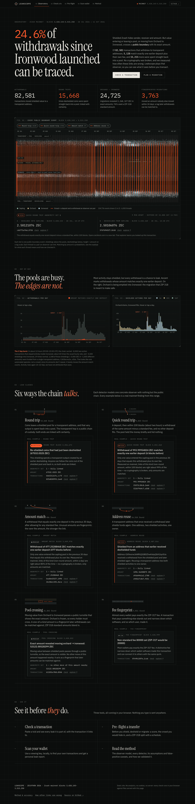
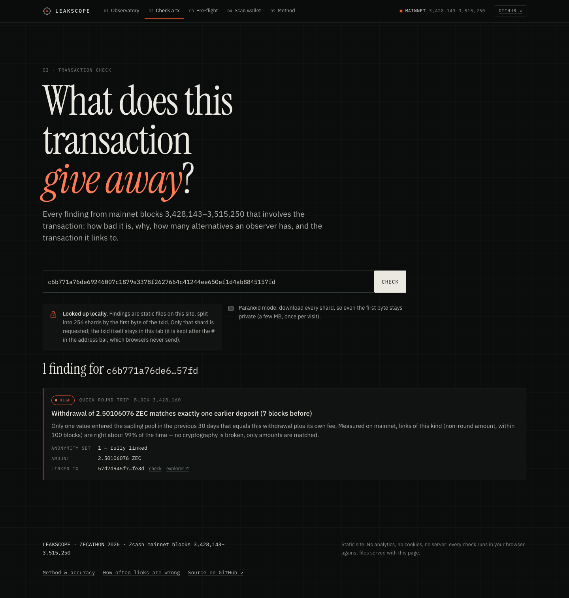
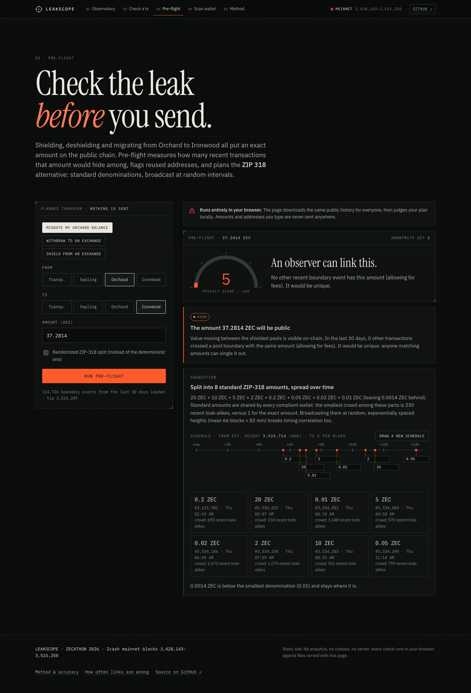
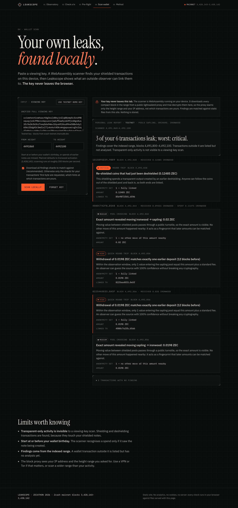

# Leakscope

**A privacy linter and observatory for Zcash: it finds where your transactions leak, before and after you send them.**

Live: **https://leakscope-cyan.vercel.app** · Findings write-up: [docs/FINDINGS.md](docs/FINDINGS.md) · License: MIT OR Apache-2.0

## The problem

Shielded Zcash transactions hide sender, receiver, amount and memo. The *edges* of the shielded pools are public: shielding (t→pool), deshielding (pool→t) and moving between Sapling, Orchard and Ironwood (the turnstile `valueBalance`) put exact amounts, addresses and timing on chain. Since NU6.3 froze Orchard (withdraw-only) at block 3,428,143, every Orchard holder has to cross a boundary, and nobody was measuring what those crossings give away.

## Headline finding

Over the first **75.6 days of Ironwood** (mainnet blocks 3,428,143–3,515,250, 584,497 transactions, after a 30-day warm-up), an observer with nothing but the public chain can link **24.6% of all deshielding transactions (20,343 of 82,581)** to where the money came from or went next:

- **5,128** (6.2%) are linked backwards to their deposit by an exact-amount match. Precision is **measured, not assumed**: in the fastest tier (within 100 blocks) a reverse-time null model found **1 coincidence against 2,535 links (≈99%)**.
- **15,668** round trips (pool → t → pool, re-shielding the very UTXO just deshielded) are deterministic links. 7,370 of them happen within 10 blocks.
- Orchard→Ironwood migrations revealed **3.27M ZEC** in 24,725 transactions. 74% used standard ZIP-318 denominations; 3,763 amounts were unique in their window.

Full numbers, method and caveats: [docs/FINDINGS.md](docs/FINDINGS.md).

| Observatory | Check a transaction |
|---|---|
|  |  |
| **Pre-flight planner** | **Wallet scan (in-browser, WASM)** |
|  |  |

## Try it in 2 minutes

| Page | What to do |
|---|---|
| [Observatory `/`](https://leakscope-cyan.vercel.app/) | The state of boundary privacy since Ironwood: daily series, linked pairs, the worst examples. |
| [Check `/check`](https://leakscope-cyan.vercel.app/check) | Paste a mainnet txid from the indexed range, e.g. [`c6b771a7…`](https://leakscope-cyan.vercel.app/check#c6b771a76de69246007c1879e3378f2627664c41244ee650ef1d4ab8845157fd). The txid stays in the URL fragment; only a 1/256 shard is fetched (or all shards in paranoid mode). |
| [Plan `/plan`](https://leakscope-cyan.vercel.app/plan) | Pre-flight: enter a planned move (e.g. Orchard → Ironwood, 13.37 ZEC). Get a score, the crowd that amount hides in, and a ZIP-318 split with delays. |
| [Scan `/scan`](https://leakscope-cyan.vercel.app/scan) | Click **Use testnet demo key**, then scan. A viewing-key scanner compiled to WASM finds the wallet's own transactions and the leaks in them, locally. |
| [Method `/method`](https://leakscope-cyan.vercel.app/method) | Every rule, its assumptions, how we validated it, and where it can be wrong. |

## What's inside

```
                 lightwalletd / Zaino (gRPC)
                            │
              ┌─────────────┴─────────────┐
              ▼                           ▼
   indexer/  (Node)                core/  (Rust)
   compact blocks → txs_*.jsonl    tx parser (v4–v6, incl. Ironwood)
   raw tx fetched only where   ◄── viewing-key scanner (Sapling/Orchard/Ironwood)
   a boundary can leak             → native binary + WASM (~281 KB brotli)
              │                           │
              ▼                           │
   engine/  (TypeScript, Node + browser)  │
   detectors · calibration · ZIP-318      │
   planner · pre-flight checker           │
        │                │                │
        ▼                ▼                ▼
   cli/  leakscope   web/  Next.js static site
   check|plan|scan   / · /check · /plan · /scan (WASM, key stays in tab) · /method
```

- `core/` — Rust. Parses raw transactions into public facts (transparent ins/outs, per-pool action counts, value balances, fee) and scans compact blocks with a UFVK. Builds a native `leakscope-parse` binary and WASM packages (`pkg-node`, `pkg-web`).
- `indexer/` — Node. Builds a dataset from any lightwalletd-compatible server. `scan-wallet.mjs` finds a wallet's own transactions from its UFVK.
- `engine/` — TypeScript leak detectors, calibration, ZIP-318 denomination planner and pre-flight scoring. Runs unchanged in Node and the browser. Being packaged as an installable SDK (`@leakscope/engine`) with examples, so wallets can lint a transaction before broadcast.
- `cli/` — `leakscope check | plan | scan`.
- `web/` — Next.js static export. No server code, no analytics, no cookies, no third-party scripts at runtime.

## How detection works

Leakscope models one adversary: someone who runs a full node or reads an explorer. They see heights, transparent addresses and values, action counts, fees and each pool's value balance. They cannot break any cryptography. Each pool boundary is a *boundary event*; nothing inside the pools is analysed.

| Detector | Rule | Severity |
|---|---|---|
| `utxo-roundtrip` | A shielding spends a transparent output created by an earlier deshielding. | critical (deterministic) |
| `address-reuse` | A shielding comes from an address that earlier received a deshielding. | high (deterministic) |
| `quick-roundtrip` / `amount-link` | A deshielding whose amount + its own (public) fee equals exactly one earlier deposit into the same pool. Tiered by delay: non-round within 100 blocks (≈99%), non-round within a day (≈85%), round amounts within 10 blocks (≈90%). | high / medium |
| `pool-crossing` | Every turnstile move, scored by how many same-amount moves happened in the window (the crowd). | medium → info |
| `fee-fingerprint` | Fee differs from the ZIP-317 conventional fee for that transaction shape. | low |

**How we measured accuracy.** An amount match can be a coincidence. To measure how often, `engine/scripts/evaluate.ts` runs the exact same matching rule *backwards in time*, against deposits made **after** each withdrawal. Money cannot leave before it arrives, so every backward match is a coincidence, and it estimates the false-link rate on the chain's real amount distribution. Results that set the tiers:

| Tier | Forward links | Reverse coincidences | Measured precision | Stated |
|---|---|---|---|---|
| non-round, ≤100 blocks | 2,535 | 1 | 100.0% | ≈99% |
| non-round, ≤1 day | 128 | 19 | 85.2% | ≈85% |
| round (0.001 ZEC multiples), ≤10 blocks | 13 | 0 | 100.0% (small sample) | ≈90% |

The naive rule ("the only matching deposit in 30 days") is wrong about half the time: 2,284 coincidences against 4,133 links (≈55% false). Links older than a day, and round amounts more than 10 blocks apart, failed this test and are **not reported**.

Ground truth: we made deliberate mistakes with our own testnet wallet and the pipeline caught both (round trip `85e9872f…` → `1d15b95d…`, quick round trip `4080c7a2…` → `8225aad0…`). Mainnet findings were spot-checked against an independent explorer (zecblock.com). Each leak class was also reproduced on a private regtest chain, and the engine has unit tests for every detector and the planner.

## Reproduce

Requirements: Rust (+ `wasm32-unknown-unknown`, `wasm-bindgen-cli`, Homebrew `llvm` for the WASM build), Node 20+, Bun.

```sh
# 1. Core: native parser (used by indexer and CLI) and WASM packages
cd core && cargo build --release && ./build-wasm.sh && cd ..

# 2. Index mainnet: 30-day warm-up (34,560 blocks) before Ironwood activation, up to the report tip
cd indexer && npm install
FROM=3393583 TO=3515250 ./index-all.sh          # writes ../data/txs_<from>_<to>.jsonl in 10k-block chunks
# single range / other server: node build-dataset.mjs --from <h> --to <h|tip> [--url zec.rocks:443] [--out ../data]
cd ..

# 3. Report: findings, summary and site data (blocks before --report-from only warm up the observer)
cd engine && bun install
bun scripts/report.ts --report-from 3428143 ../data/report-final ../data/txs_*.jsonl

# 4. Evaluate: reverse-time null model
bun scripts/evaluate.ts --report-from 3428143 ../data/txs_*.jsonl --json ../data/report-final/evaluation.json
bun test                                          # engine unit tests
cd ..

# 5. Site: copy data/report-final/* to web/public/data/, then
cd web && npm install && npm run build            # static export in web/out
```

## CLI

```sh
cd cli && bun install
bun src/main.ts check <txid> [--testnet] [--data ../data]
bun src/main.ts plan --from orchard --to ironwood --amount 13.37 [--to-address t1…] [--data ../data]
LEAKSCOPE_UFVK=uview… bun src/main.ts scan --from <birthday height> [--to <height>] [--data ../data]
#   or --ufvk-file <path>, to keep the key out of shell history and `ps`
```

`check` fetches the live transaction from `zec.rocks:443` (or `testnet.zec.rocks:443`), parses it locally and prints what anyone can see plus findings; with `--data` it also matches against the indexed history. Pools: `transparent`, `sapling`, `orchard`, `ironwood`.

## Privacy model

- **Your viewing key never leaves your machine.** On `/scan` it lives inside a WASM module in the tab; trial decryption is local. Compact blocks come from a public lightwalletd gRPC-web proxy, which learns the block range and your IP, not your key or your transactions.
- **Check** downloads one shard named by the first byte of the txid (shared by ~1/256 of all transactions), or every shard in paranoid mode. The txid stays in the URL fragment, which browsers never send.
- **Plan** downloads the same public event index for everyone and computes locally. Randomness for ZIP-318 splits comes from the browser's CSPRNG.
- **Explorer links are opt-in** and labelled.
- The site is static: no backend, no analytics, no cookies, no runtime third-party scripts or fonts.

## Limitations and honest caveats

- Amount links are probabilistic. "Anonymity set of 1" means no other deposit fits, not proof. Precision figures are estimates from a null model, measured on the first part of the range where a full reverse window exists.
- These are **lower bounds**: a real observer adds network metadata, wallet fingerprints and off-chain knowledge (exchange records, KYC).
- Address reuse is concentrated: 66% of the 16,510 reuse findings come from a single address, very likely a service, not an individual.
- Custodians batch users; a link may connect a user to an exchange rather than to a person.
- Fees (and hence exact-fee matches) are only computed when every input value is known.
- Fully shielded transactions are not analysed beyond existence, timing and shape. `/check` covers the indexed range only; the CLI checks any transaction live.
- NU7 is expected on mainnet soon after this submission. The parser targets v4–v6 transactions; our testnet ground-truth transactions were made on the current testnet, but mainnet behaviour after NU7 will need re-validation.

## Roadmap

- `@leakscope/engine` as an installable SDK with examples, so wallets can run pre-flight checks before broadcast and warn on round trips, address reuse and unique amounts.
- PCZT input for pre-flight (lint the exact transaction a wallet is about to sign).
- Continuous indexing so the observatory stays current, and NU7 support.
- Wallet-side defaults informed by the data: ZIP-318 denominations and randomized delays for migrations.

## License

Dual-licensed under MIT OR Apache-2.0, at your option. See [LICENSE](LICENSE), [LICENSE-MIT](LICENSE-MIT) and [LICENSE-APACHE](LICENSE-APACHE).

Built by Adit ([@AdityaWisnuu](https://github.com/AdityaWisnuu)) for ZECATHON 2026.
